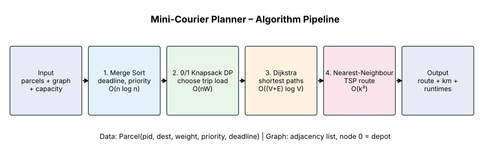

# Mini-Courier Planner (DAA Capstone – ETCCDA302)

**Student:** Shashank Sain  |  **Roll No:** 25013550023  |  **Programme:** B.Tech CSE (FSD)
**Course:** Design & Analysis of Algorithms – K.R. Mangalam University, Gurugram  |  **Faculty:** Dr. Shweta Agarwal

## How to run
```
python courier_planner.py
```
Requires Python 3.9+ and `matplotlib` (only for charts): `python -m pip install matplotlib`.
Output is printed and saved to `runtime_sorting.png` and `runtime_pipeline.png`. The `data` folder must exist next to the script, because the demo writes `data/sample_small.json`. A captured run is in `output_log.txt`.

To plan an unseen dataset from a JSON file:
```
python courier_planner.py data/sample_unseen.json
```
JSON format: `{"edges": [[u, v, km], ...], "capacity": 15, "parcels": [{"pid":1,"dest":3,"weight":6,"priority":7,"deadline":4}, ...]}`. Node 0 is the depot. A captured run is in `unseen_output_log.txt` (selects P5, P1, P4 with priority 18, route 0→2→4→3→0, 18 km).

## Project files
| File | Purpose |
|---|---|
| `courier_planner.py` | Complete program (sorting, knapsack, Dijkstra, TSP, benchmark) |
| `data/sample_small.json`, `data/sample_unseen.json` | Sample datasets |
| `output_log.txt`, `unseen_output_log.txt` | Captured program output |
| `design_diagram.png`, `runtime_sorting.png`, `runtime_pipeline.png` | Design diagram and runtime charts |

## Phase 1 – Design


| Item | Design |
|---|---|
| Parcel | `pid, dest (graph node), weight (kg), priority (1–10), deadline (hours)` |
| Delivery points | Nodes of an undirected weighted graph; node 0 = depot |
| Graph format | Adjacency list `{u: [(v, km), ...]}` |
| Flow | Sort → Knapsack (choose trip load) → Dijkstra (distances) → Nearest-Neighbour TSP (visit order) |

| Step | Algorithm | Why chosen | Complexity |
|---|---|---|---|
| Prioritise | Merge sort on `(deadline, -priority)` | Stable, worst case O(n log n) | Time O(n log n), space O(n) |
| Pack the van | 0/1 Knapsack DP (value = priority, weight = kg) | Each parcel is taken whole or not at all; greedy is not optimal | Time O(nW), space O(nW) |
| Distances | Dijkstra with min-heap | Non-negative road lengths | O((V+E) log V) per source |
| Route | Nearest-Neighbour TSP | TSP is NP-hard; greedy gives a fast approximation | O(k²) distance lookups for k stops (+ one Dijkstra run per visited stop) |

## Phase 2 – Sample result (6 parcels, 20 kg)
Sorted order by deadline/priority: P4, P2, P6, P1, P3, P5.
Knapsack selects **P4, P1, P3, P5** (18 kg, total priority 26). The DP table is built in `knapsack()` and backtracked to list the chosen parcels.

## Phase 3 – Route
Stops order: `0 → 1 → 3 → 4 → 6 → 0`; real road path `0-2-1-3-4-5-6-0`; **total 24 km**. Dijkstra outputs from the depot are printed in the log.

## Phase 4 – Performance (seconds; best of 3 runs, routing step timed once)
| n parcels | Merge sort | Insertion sort | Knapsack | Dijkstra + NN |
|---|---|---|---|---|
| 50 | 0.00008 | 0.00011 | 0.00065 | 0.00065 |
| 100 | 0.00020 | 0.00044 | 0.00135 | 0.00108 |
| 200 | 0.00111 | 0.00173 | 0.00260 | 0.00423 |
| 400 | 0.00093 | 0.00800 | 0.00590 | 0.01582 |
| 800 |